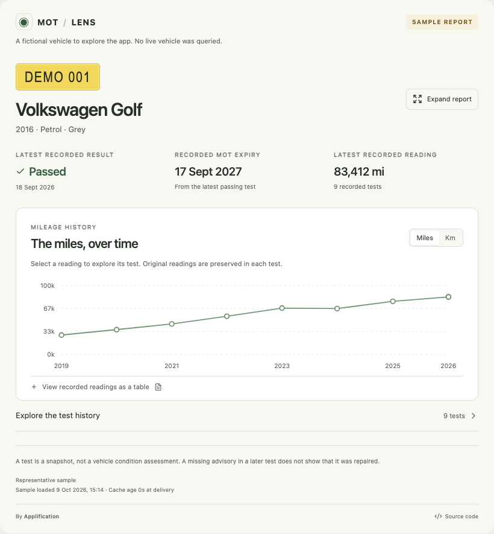

# MOT Lens

A free, open-source MCP App by [Applification](https://applification.net) for understanding one vehicle's MOT history inside ChatGPT. It shows recorded facts and helps the host conversation explain them, without a condition score or buying verdict.



The report provides a compact vehicle summary, an interactive mileage chart, chronological tests, original failure/advisory wording and evidence-linked observations. Selecting a test updates the host's conversation context. Follow-up explanations use ChatGPT; MOT Lens makes no paid model API calls.

## Run locally

Use Bun 1.4.0 and Node 24+. The workspace uses React/Vite, TypeScript, Zod and the current MCP Apps bridge.

```sh
git clone https://github.com/rufushudson/mot-lens.git
cd mot-lens
# Until the implementation PR is merged:
git switch feat/mot-lens
bun install --frozen-lockfile
bun run build
bun run dev
```

Open `http://127.0.0.1:5173` for the development host. It makes real MCP calls to `http://127.0.0.1:8787/mcp` and loads the exact built UI resource. It is a test host, not a consumer website or a ChatGPT model. `?source=dev` opts into Vite UI hot reload; rebuild to refresh the production resource.

Without credentials, the explicitly fictional **DEMO001** sample works. Real requests return `NOT_CONFIGURED`; sample data is never silently substituted. For live records, register with [DVSA](https://documentation.history.mot.api.gov.uk/mot-history-api/register/), copy `.env.example` to `.env`, and set the five issued server variables. Restart the local MCP server. Hosted secrets are separate; see [hosting](docs/HOSTING.md).

```sh
bun run control doctor
bun run control sample
bun run control lookup "AB12 CDE"
bun run control resource
bunx playwright install chromium
bun run verify
```

## Connect and contribute

Use [the ChatGPT connection guide](docs/CHATGPT.md) for the public HTTPS endpoint and installation steps. [Submission materials](docs/SUBMISSION.md) include a draft plugin package, review cases and recording script. A reachable developer endpoint does not mean approved public distribution.

See [DVSA integration and accuracy](docs/DVSA.md), [environment variables](docs/ENVIRONMENT.md), [architecture](docs/ARCHITECTURE.md), [feature controls](docs/FEATURES.md) and [verification evidence](.astack/report/verification.md).

The hosted deployment supports live DVSA lookups. Authentication and an owner-supplied vehicle were verified on 19 October 2026. Automated tests also exercise explicit fixtures, the MCP protocol, Cloudflare's local runtime and the packaged app through the standard bridge. Actual ChatGPT installation remains a separate verification step.

## Licence and scope

Code: [MIT](LICENSE). Official records: DVSA MOT History API, with public-sector attribution under [OGL v3](https://www.nationalarchives.gov.uk/doc/open-government-licence/version/3/). Sample records are fictional. MOT records describe a test at a point in time, not current roadworthiness. Neither DVSA nor OpenAI endorses MOT Lens.

No accounts, payments, application database, analytics, monitoring jobs or bulk imports. Vehicle/token caching is bounded ephemeral server memory. The production server exposes MCP, health and policy endpoints; its React interface is an MCP resource.
