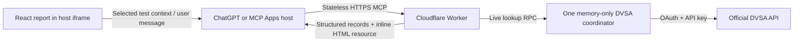

# Architecture

`packages/domain` owns schema parsing, chronological records, exact-unit comparison,
observations, provenance and selected-record context. Pure functions carry no secrets/UI state.
`packages/ui` renders the report with props and callbacks. `apps/mcp-ui` owns the MCP Apps
bridge, host theme/display mode, local selection and serialized context updates. It validates
every delivered result and clears stale selection on new/cancelled/malformed/error outcomes.
`ReportSession` owns the generation and context queue: superseded completions cannot
replace a report, confirm a selection or send a waiting explanation. Teardown closes that
scope. An already-sent context request is followed by the current replacement in order.

`apps/mcp` owns DVSA authentication, bounded cache/queue, errors, two tool definitions and
the HTML resource. `get_vehicle_history` is a headless read-only lookup; `show_vehicle_report`
returns the same typed outcome plus the UI resource association, with explicit sample support.
Text summaries work in clients without an app renderer. Only the UI tool advertises the app.

Transport is current stateless Streamable HTTP using the MCP SDK's web-standard transport.
Each POST owns a fresh server/transport and closes them after producing its JSON response.
There are no resumable sessions or required GET SSE streams. Incoming bodies are actually
stream-counted/capped at 32KiB; the same byte reader bounds upstream JSON to 1MB and cancels
overflowing streams. Explicit ChatGPT/loopback browser origins and public request limits
precede execution. Origin trust never comes from the caller's Host header; SDK calls without
an Origin remain supported.
Registrations/text are data, never executable markup or instructions. React escapes record
text; model context explicitly marks defect wording as untrusted record data.

Vite builds a single inline HTML file, embedded server-side as `ui://mot-lens/report-v1.html`,
MIME `text/html;profile=mcp-app`. No external fonts/scripts/data connections are required;
CSP connection/resource domains are empty. Public source/branding links are ordinary user
navigation. The production build excludes the development host and its debugging controls.

No paid model calls. `ui/update-model-context` shares the selected immutable test. `ui/message`
sends an explanatory prompt carrying that same record, after queued context updates settle.
Unsupported host messaging disables the button; failed updates/messages/display changes have
explicit fallbacks. Expansion still works inline when fullscreen is unavailable.

Local Node uses one in-process service. Cloudflare routes live lookups from all regions to
one named Durable Object for global pacing. It never calls storage/SQL and loses memory on
hibernation; cache/token reuse is opportunistic and always reports actual age. This tradeoff
preserves the requested no-database first version. No accounts, payment or autonomous jobs.
